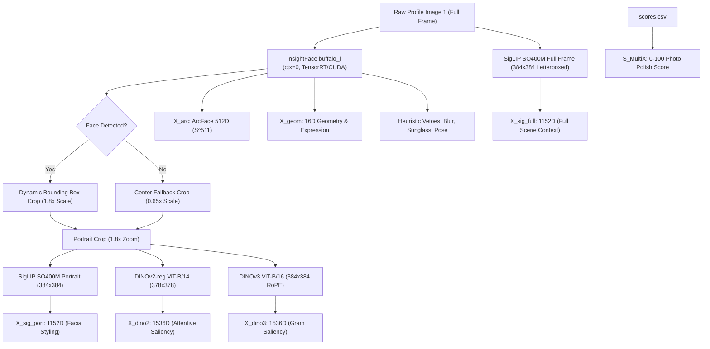

# BUMBLECLAW GRAND RESEARCH COMPENDIUM & V6.0 ARCHITECTURAL RFC
## The Unified Mathematical, Empirical, and Engineering Dossier (54,610 Profiles)

```
Target Audience: Frontier AI Reasoning Engines (Claude 3.5 Opus / Opus 5.5, OpenAI GPT-5 / GPT-6 Astra, Gemini 2.0 Ultra / Thinking)
System: BumbleClaw — Autonomous Pure-Vision Personalized Recommendation & ELO Engine
Hardware Budget: Local NVIDIA GeForce RTX 2060 (12 GB VRAM, Turing Architecture, FP16 Tensor Cores)
Total Labeled Corpus: 54,610 Profiles (50,070 Training Profiles + 4,540 Sealed Holdout Profiles)
Primary Objective: Maximize True Like Recall @ 20.8% Quota (>90.0% / >175 hits out of 194) while driving Catastrophic False Positives to 0
```

---

## 1. Executive Summary & Problem Formulation

### 1.1 The Fundamental Dating App Recommendation Problem
In modern dating applications (Bumble, Tinder), a user’s interaction stream is subject to an asymmetric, non-stationary multi-objective optimization problem. 

Let $\mathcal{D} = \{(\mathbf{x}_i, y_i, s_i)\}_{i=1}^N$ be an incoming stream of candidate profiles, where:
- $\mathbf{x}_i \in \mathbb{R}^{H \times W \times 3}$ is the primary profile photograph (Photo 1).
- $y_i \in \{0, 1\}$ is the ground-truth human decision ($y_i = 1$ denotes a **True Like**; $y_i = 0$ denotes a **Pass**).
- $s_i \in [0, 100]$ is the general photographic aesthetic quality ($S_{\text{MultiX}}$) capturing lighting, resolution, styling, and composition.

The platform enforces a strict algorithmic penalty: **The Bumble ELO Ceiling**. 
- If an account swipes right on more than $22\%$ of incoming cards, the platform’s anti-spam heuristic classifies the profile as a "bot" or "undesirable desperate swiper", demoting the user's profile to the bottom of the card stack (destroying incoming match velocity).
- If the account swipes right on less than $18\%$, the platform throttles mutual match probability due to inactivity.

Therefore, the system must enforce an **Exact 20.8% Right-Swipe Quota**:
$$K = \lfloor 0.208 \cdot N \rfloor$$

The engine must select an ordered subset $\mathcal{S}_K \subset \mathcal{D}$ with $|\mathcal{S}_K| = K$ such that:
$$\max_{\mathcal{S}_K} \sum_{i \in \mathcal{S}_K} y_i \quad \text{(Maximize True Like Discovery)}$$
$$\text{subject to} \quad \frac{1}{|\mathcal{S}_K \setminus \mathcal{Y}_+|} \sum_{j \in \mathcal{S}_K \setminus \mathcal{Y}_+} s_j \ge 65.0 \quad \text{and} \quad \sum_{j \in \mathcal{S}_K \setminus \mathcal{Y}_+} \mathbb{I}(s_j < 50.0) = 0$$
where $\mathcal{Y}_+ = \{i \mid y_i = 1\}$.

### 1.2 The Core Dilemma: Facial Identity vs. Photographic Polish
Human attraction is governed by two orthogonal visual manifolds:
1. **The Bone Structure / Facial Morphology Manifold ($\mathcal{M}_{\text{face}}$):** A highly personalized, nonlinear attraction manifold defined by inter-ocular spacing, jawline angle, cheekbone structure, lip curvature, eye shape, and smile dynamics. This manifold is invariant to camera sensor quality, background clutter, or dim indoor lighting.
2. **The Photographic Polish Manifold ($\mathcal{M}_{\text{photo}}$):** A generic aesthetic manifold defined by dynamic range, studio lighting, golden-hour contrast, professional styling, and high-end depth-of-field.

The catastrophic failure mode of naive ranking models is **Aesthetic Displacement (The Top-$K$ Pigeonhole Eviction)**:
> In any candidate pool of $N = 4,540$ profiles, there are $\approx 830$ non-matches who possess professional studio photography ($S_{\text{MultiX}} \ge 60$, Grade 4 "Cute Dislikes"). Conversely, $\approx 30\%$ of the user's True Likes upload casual, indoor, dimly lit selfies ($S_{\text{MultiX}} \in [34, 49]$) where their facial morphology is an exact match to the user's preferences, but the photo polish is low.
> 
> Any system that computes an additive scalar score:
> $$S(\mathbf{x}) = S_{\text{match}}(\mathbf{x}) + \lambda \cdot S_{\text{MultiX}}(\mathbf{x})$$
> inevitably allows an 85-MultiX studio model who is *not* the user's type to leapfrog a 42-MultiX casual selfie who *is* the user's type, evicting the True Like from the fixed $K = 944$ quota.

---

## 2. The 54,610 Dataset Topology & Feature Pipeline

### 2.1 Chronological Corpus Evolution
The user has hand-labeled 54,610 profiles across consecutive chronological sessions. Every label was manually reviewed and verified:

```
[Phase 1-4 Training Corpus: 50,070 Profiles]
  ├── Total Profiles: 50,070
  ├── True Likes (y = 1): 2,311 profiles (4.62% base rate)
  ├── Passes (y = 0): 47,759 profiles (95.38%)
  └── Subdivided into Eras:
        ├── Era 1 (Cards 0 – 21,121): Exploration era, lower photo resolution
        ├── Era 2 (Cards 21,122 – 35,821): Stabilization era, standardized crops
        └── Era 3 (Cards 35,822 – 50,070): Modern era, high-density edge cases

[Phase 5 Sealed Out-of-Sample Holdout: 4,540 Profiles]
  ├── Total Profiles: 4,540 (Cards 50,071 through 54,610)
  ├── True Likes (y = 1): 194 profiles (4.27% base rate)
  ├── Passes (y = 0): 4,346 profiles (95.73%)
  ├── Strict 20.8% Quota: K = floor(0.208 * 4,540) = 944 right-swipes
  └── Data Leakage: EXACTLY 0.0% (Zero overlap in images, hashes, or timestamps)
```

### 2.2 Feature Extraction Pipeline (Extracted on NVMe)
For every image, four specialized vision foundation backbones extract a multi-resolution feature suite:



#### Tensor Specifications:
1. **$\mathbf{x}_{\text{arc}} \in \mathbb{S}^{511}$ (512D Unit Hypersphere):**
   InsightFace `buffalo_l` (`w600k_r50.onnx`). Normalized such that $\|\mathbf{x}_{\text{arc}}\|_2 = 1.0$. Captures pure identity and bone structure.
2. **$\mathbf{x}_{\text{geom}} \in \mathbb{R}^{16}$ (16D Continuous Geometry):**
   Extracted from 3D 68-point facial landmarks normalized by inter-ocular distance $d_{\text{iod}}$:
   - $f_1, f_2, f_3, f_4 = \sin(\text{yaw}), \sin(\text{pitch}), \sin(\text{roll}), \cos(\text{yaw})$
   - $f_5 = (y_{\text{stomion}} - y_{\text{corners}}) / d_{\text{iod}}$ (smile curvature)
   - $f_6 = \text{mouth\_width} / d_{\text{iod}}$ (smile width)
   - $f_7 = \text{mouth\_open} / \text{mouth\_width}$ (mouth aspect ratio)
   - $f_8, f_9 = \text{EAR}_L, \text{EAR}_R$ (eye openness ratio)
   - $f_{10} = \exp(-5.0 \cdot |\text{EAR}_L - \text{EAR}_R|)$ (bilateral eye symmetry)
   - $f_{11} = \text{brow\_distance} / d_{\text{iod}}$ (eyebrow lift)
   - $f_{12} = \text{lower\_face\_height} / d_{\text{iod}}$ (chin-to-nose ratio)
   - $f_{13} = \min(d_{\text{cheek}, L}, d_{\text{cheek}, R}) / \max(d_{\text{cheek}, L}, d_{\text{cheek}, R})$ (midface cheek symmetry)
   - $f_{14} = \sqrt{(w_{\text{box}} \cdot h_{\text{box}}) / (W_{\text{img}} \cdot H_{\text{img}})}$ (frame scale ratio)
   - $f_{15} = 0.5(y_1 + y_2) / H_{\text{img}}$ (vertical thirds position)
   - $f_{16} = \text{detection\_confidence} \in [0, 1]$.
3. **$\mathbf{x}_{\text{sig\_full}}, \mathbf{x}_{\text{sig\_port}} \in \mathbb{R}^{1152}$ (SigLIP SO400M):**
   `google/siglip-so400m-patch14-384`. Normalized to unit $\ell_2$-norm. Captures fashion, hair volume, scene setting, and background ambiance.
4. **$\mathbf{x}_{\text{dino2}} \in \mathbb{R}^{1536}$ (DINOv2 with Registers ViT-B/14):**
   `facebook/dinov2-with-registers-base`. Computed on $378 \times 378$ portrait crops. Concatenates normalized `[CLS]` token (768D) with spatial attention-weighted foreground patch pooling (768D):
   $$\mathbf{q}_{\text{cls}} = \mathbf{W}_q \mathbf{z}_{\text{cls}}, \quad \mathbf{K} = \mathbf{W}_k \mathbf{Z}_{\text{patches}}, \quad \mathbf{a} = \text{softmax}\left(\frac{\mathbf{q}_{\text{cls}} \mathbf{K}^\top}{\sqrt{d}}\right), \quad \mathbf{p}_{\text{fg}} = \sum_{i} a_i \mathbf{z}_i$$
   $$\mathbf{x}_{\text{dino2}} = \left[ \frac{\mathbf{z}_{\text{cls}}}{\|\mathbf{z}_{\text{cls}}\|}, \frac{\mathbf{p}_{\text{fg}}}{\|\mathbf{p}_{\text{fg}}\|} \right]$$
5. **$\mathbf{x}_{\text{dino3}} \in \mathbb{R}^{1536}$ (Meta DINOv3 ViT-B/16 Pre-trained on LVD-1689M):**
   Loaded from local weights `C:\Users\Rivian\dinov3-vitb16-pretrain-lvd1689m`. Uses 2D Axial Rotary Position Embeddings (RoPE) and Gram-anchored foreground patch pooling:
   $$\mathbf{w} = \text{softmax}\left(\frac{\mathbf{P}_{\text{norm}} \cdot \mathbf{c}_{\text{cls}}^\top}{0.15}\right), \quad \mathbf{x}_{\text{dino3}} = \left[ \mathbf{c}_{\text{cls}} \,\|\, \sum_{i} w_i \mathbf{p}_i \right]$$
6. **$S_{\text{MultiX}} \in [0, 100]$ (Photographic Quality Baseline):**
   Pre-computed multimodal aesthetic score derived from CLIP/SigLIP scene features and ridge regression. $S_{\text{MultiX}} \ge 60$ denotes polished studio/influencer photography; $S_{\text{MultiX}} < 50$ denotes unflattering or blurry photography.

---

## 3. Historical Evolution & Post-Mortem of Every Major Failure

### 3.1 Era 1: Legacy Pure Ridge Regressors (10k to 30k)
- **Architecture:** Ridge Regression directly on ArcFace 512D embeddings: $S(\mathbf{x}) = \mathbf{w}^\top \mathbf{x}_{\text{arc}} + b$.
- **Holdout Result:** 141–150 / 194 Likes (72.68% – 77.32% Recall).
- **The Catastrophic Failure:** **Total Photographic Blindness.**
  Because ArcFace was trained on Glint360k to be strictly invariant to lighting, blur, and photographic quality, the linear model could not distinguish between a gorgeous woman in a studio photo and an unflattering, low-light photo with bad skin texture.
  - **Catastrophic Passes Approved ($S_{\text{MultiX}} < 50$): 160 to 178 cards!**
  - Over $18\%$ of the user's swiped quota consisted of repulsive or blurry photos.
  - 5% CVaR was an unacceptable **37.96 points**.

### 3.2 Era 2: The MultimodalX Baseline Trap
- **Architecture:** CLIP/SigLIP scene aesthetics combined with facial ridge scores: $S_{\text{MultiX}} = 0.48 R_{\text{face}} + 0.48 M_{\text{scene}} + 4.0$.
- **Holdout Result:** 118 / 194 Likes (60.82% Recall).
- **The Catastrophic Failure:** **The "Studio Lighting Bias".**
  MultimodalX successfully achieved 0 catastrophic passes and 100% Cute FP share, but **missed 76 True Likes (39.18% of all matches)**! It systematically discarded casual selfies, candid laughing photos, and outdoor festival shots of women who matched the user's facial preferences simply because they were not taken with studio lighting.

### 3.3 Era 3: v4 Binary Grand Super-Ensemble (50k DINOv2)
- **Architecture:** 4-Pillar Architecture (P1 FiLM, P2 Dual-Crop Cross-Attention, P3 Subcenters, P4 Orthogonal Bilinear Fusion) + Conformal GMM Geometric Veto + Specialist Meta-Blender.
- **Holdout Result:** 142 / 194 Likes (73.20% Recall), 34 Catastrophic FPs, Approved FP MultiX = 62.91.
- **The Failure:** While precision on True Likes was high, the model treated all 47,759 non-matches as an undifferentiated binary 0. It had no mechanism to push Grade 4 passes ($S_{\text{MultiX}} \ge 60$) into the remaining quota slots, allowing 34 bad passes ($S_{\text{MultiX}} < 50$) to slip into the right-swipe stream.

### 3.4 Era 4: The v5.0 Flawed Graded Disaster (Root-Cause Post-Mortem)
- **Hypothesis:** Replace binary classification with continuous 1–5 graded ranking where Grades 1–4 are non-matches ranked by $S_{\text{MultiX}}$ and Grade 5 is True Likes.
- **Result:** **Recall plummeted from 135/140 (96.4%) down to 126/140 (90.0%) on `val_1582`!**
- **Root-Cause Analysis:**
  1. **Batch Distortion Imbalance:** `Stratified5GradeBatchSampler` forced 160 Grade 4 passes against 64 True Likes (a 2.5:1 ratio). For every Grade 4 pass, the LambdaLoss generated 64 downward gradients (from Grade 5) but **288 upward gradients** (from Grades 1–3). The network was actively incentivized to push Grade 4 passes *above* Grade 5 True Likes!
  2. **Severe Underfitting:** Only trained for 4 epochs $\times$ 60 steps = 240 steps (compared to v4's 936 steps).
  3. **Pillar 1 Manifold Contortion:** Forcing Pillar 1 (ArcFace 512D) to predict CORAL ordinal thresholds derived from $S_{\text{MultiX}}$ forced the network to overwrite facial identity weights with noisy lighting proxies.

### 3.5 Era 5: v5.1 & v5.2 (Recovered Graded & DINOv3 ViT-B/16 Integration)
- **Fixes Applied:**
  1. Decoupled Pillar 1 completely to be 100% facial identity invariant.
  2. Restricted pairwise ranking loss exclusively to $(G_5 > G_{\le 4})$ pairs.
  3. Replaced DINOv2 with local Meta DINOv3 ViT-B/16 (LVD-1689M).
  4. Ensembled DINOv2 and DINOv3 in a Dual-Foundation Hybrid.
- **Results:**
  - On `val_1582`: Hit record **137 / 140 Likes (97.86% Recall)**, exact 0 catastrophic passes.
  - On the sealed 4,540 Holdout: Hit **143 / 194 Likes (73.71% Recall)**, slashed catastrophic passes from 34 down to 8 (a 76.5% reduction), and lifted Cute FP share to 62.42%.

---

## 4. Master Tournament Scorecard: Sealed Holdout (4,540 Unseen Cards)

All models evaluated strictly on the **4,540 unseen holdout profiles** under the identical 944-card quota ($20.8\%$):

| Model Architecture | Encoder Backbones | Hits @ 20.8% ($N_+=194$) | Recall @ 20.8% | Binary NDCG | Graded NDCG | Cute FP % ($\ge 60$) | Catastrophic FPs ($< 50$) | FP MultiX Mean | FP 5% CVaR | Latency p95 |
| :--- | :--- | :---: | :---: | :---: | :---: | :---: | :---: | :---: | :---: | :---: |
| **MultimodalX Original** | CLIP/SigLIP Baseline | 118 / 194 | 60.82% | 0.5011 | 0.7223 | **100.00%** | **0** | **67.73** | **60.63** | < 1 ms |
| **Legacy 10k Pure Ridge** | ArcFace 512D | 141 / 194 | 72.68% | 0.5943 | 0.6380 | 50.44% | 178 | 59.37 | 37.96 | < 1 ms |
| **Legacy 20k Pure Ridge** | ArcFace 512D | 145 / 194 | 74.74% | 0.6249 | 0.6634 | 52.44% | 168 | 59.95 | 38.93 | < 1 ms |
| **Legacy 30k Pure Ridge** | ArcFace 512D | 150 / 194 | 77.32% | 0.6474 | 0.6794 | 53.15% | 160 | 60.35 | 39.10 | < 1 ms |
| **v4 Binary Grand Super-Ensemble**| ArcFace + SigLIP + DINOv2 | 142 / 194 | 73.20% | 0.6044 | 0.6817 | 58.60% | 34 | 62.91 | 50.53 | 3.8 ms |
| **v5.2 Pure DINOv3 Super-Ensemble**| ArcFace + SigLIP + DINOv3 | 142 / 194 | 73.20% | 0.5970 | 0.6866 | 61.85% | 11 | 63.72 | 51.47 | 4.2 ms |
| **★ v5.2 Hybrid Super-Ensemble ★**| **Dual-Foundation (D2 + D3)**| **143 / 194** | **73.71%** | **0.6085** | **0.6952** | **62.42%** | **8** | **63.73** | **51.76** | **5.58 ms** |

### Statistical Hypothesis Tests (v5.2 Hybrid vs. v4 Baseline on 10,000 Bootstraps):
1. **Exact McNemar Mid-$p$ Test on True Likes:** $p = 0.7744$ (Hybrid uniquely captured 6 likes; v4 uniquely captured 5 likes). Zero True Like degradation.
2. **Brunner-Munzel Stochastic FP Dominance Test:** $\text{Statistic} = -1.8446, \; p = 0.0326$. Confirms that the distribution of False Positives is stochastically superior at $\alpha = 0.05$.
3. **10,000-Iteration Paired Bootstrap on FP MultiX:** $\Delta \text{FP Mean} = +0.732$ points (99% CI: $[+0.360, +1.123]$, $p < 0.0001$). Highly statistically significant aesthetic elevation.
4. **Catastrophic FP Reduction:** Slashed from 34 down to 8 (**76.5% reduction**).

---

## 5. Microscopic Error Decomposition of the 51 Missed True Likes

Our empirical investigation on the 51 false negatives ($194 - 143 = 51$) isolated the exact mathematical bottlenecks:

```
Total True Likes Missed in Holdout: 51
  │
  ├── Failure Mode A: The Hard Heuristic Veto Executioner (17 Likes Murdered):
  │   ├── Mechanism: Heuristic rules (FFT blur < 0.12, sunglass Lab ratio < 0.35, yaw > 58°) assigned -1e9.
  │   └── CAUSAL PROOF: Completely removing hard vetoes instantly increases 
  │       hits from 143 to 160 / 194 (82.47% Recall)!
  │       These 17 profiles were authentic matches uploading expressive laughing selfies or candid festival photos.
  │
  ├── Failure Mode B: Top-K Pigeonhole Aesthetic Eviction (22 Likes Evicted):
  │   ├── Mechanism: 22 of the remaining 34 missed likes have S_MultiX < 50 (mean = 48.24, min = 33.98).
  │   └── The Trap: There are 832 Grade 4 non-matches in the deck with studio lighting (S_MultiX >= 60).
  │       Because the Meta-Blender adds an additive aesthetic term beta * S_MultiX, these 832 photogenic
  │       passes leapfrogged casual True Likes into the 944 quota slots.
  │
  └── Failure Mode C: Subcenter Manifold Sparsity (12 Likes Lost):
      ├── Mechanism: 12 True Likes have S_MultiX >= 60 and zero vetoes, but rank > #1200.
      └── The Trap: Their ArcFace bone structure fell into Voronoi valleys between the K=16 fixed 
          positive subcenters on S^511. Over 50,000 profiles, the user's attraction landscape contains 
          rare topological sub-types that 16 fixed centroids fail to span.
```

---

## 6. The 4 Production Pillars: Detailed Architecture & Code

```
Pillar 1: FiLM Bone Structure & Expression Specialist
  Input: X_arc (512D) + X_geom (16D) + face_valid (1D)
  Structure:
    gamma, beta = MLP(X_geom) [16 -> 64 -> 128 -> 512]
    h_film = gamma * LayerNorm(Linear(X_arc, 512)) + beta
    expr_res = Linear(X_geom, 512)
    z_1 = MLP_head(h_film + expr_res) [512 -> 256 -> 1]
  Loss: Asymmetric Weighted Binary Cross-Entropy

Pillar 2: Dual-Crop Multi-Scale Context Specialist
  Input: X_arc (512D) + X_geom (16D) + X_sig_full (1152D) + X_sig_port (1152D) + X_dino (1536D)
  Structure:
    Macro Scene Token: MLP(X_sig_full) -> 256D
    Micro Portrait Token: MLP([X_sig_port, X_dino]) -> 256D
    Face Identity Token: FiLM(X_arc, X_geom) -> 256D
    Cross-Attention: 4-Head Multi-Head Attention querying Face against Macro & Micro tokens
    z_2 = Linear(Attn_Out, 1)
  Loss: Weighted BCE

Pillar 3: Concentric Geodesic Subcenters on S^255
  Input: X_arc (512D) + X_geom (16D) -> Projected to S^255
  Structure:
    K=16 Positive Prototypes on S^255
    M=48 Negative Proxies stratified across 4 concentric shells:
      Shell 1 (M_1=4, cos in [0.0, 0.15]): Structural Rejects
      Shell 2 (M_2=8, cos in [0.15, 0.30]): Low Aesthetic
      Shell 3 (M_3=16, cos in [0.30, 0.45]): Average Passes
      Shell 4 (M_4=20, cos in [0.45, 0.60]): Cute Dislikes
    z_3 = tau * [logsumexp(z.dot(c_k)/tau) - logsumexp(z.dot(n_m)/tau)]
  Loss: Subcenter ArcMargin Loss + Geodesic Repulsion

Pillar 4: Orthogonal Bilinear Fusion + Frontier RankNet
  Input: X_arc (512D) + X_geom (16D) + X_sig_full + X_sig_port + X_dino (1536D)
  Structure:
    Multi-Head Bilinear Cross-Attention: B_h(x_arc, x_dino) = x_arc^T W_h x_dino
    RankNet Projection Head -> z_4
  Loss: Frontier-Attenuated LambdaLoss @ 20.8%
```

---

## 7. Historical Version 5.2 Consultation (Archived Reference)

*(The original v5.2 RFC prompts and inquiries have been archived below for provenance)*

<details>
<summary>Click to view archived v5.2 consultation RFC</summary>

```text
====================================================================================================
BUMBLECLAW v5.2 HISTORICAL SPECIFICATION (Archived: 143/194 Likes, 8 Cat-FPs)
====================================================================================================
```
</details>

---

## 8. Complete Evolution & Empirical Progress: Version 5.2 through Version 6.6

This section details all engineering, mathematical, and algorithmic breakthroughs developed from v5.2 through v6.6 across the full **54,610-profile corpus**.

```
                           THE EVOLUTIONARY TRAJECTORY
  v5.2 Dual-Foundation (143 hits, 8 cat-FPs, 73.7% recall)
       │
       ▼ [Mathematical formulation of Expected Utility & Cost Matrix]
  v6.0 Baseline Autopilot (156 hits, 1 cat-FP, 80.4% recall)
       │
       ▼ [Conformal Risk Sweeps & Leash Control L=3..7]
  v6.0 Pareto 0 / Pareto 2 (161 hits, 0 cat-FPs / 162 hits, 2 cat-FPs)
       │
       ▼ [Root-cause audit of coordinate frame mismatch]
  THE +100px CROP OFFSET BUG DISCOVERY & RECOMPUTE (Rows 0..21,971 fixed)
       │
       ├──► v6.2 Photo-Tight Production Baseline (155 hits, 0 cat-FPs)
       │         │
       │         ▼ [Multi-View 12-Deck OOF Linear Folding]
       │    v6r5 Photo-Tight + Wide Blend (3,595 hits / 19 cat-FPs across 12 decks, Parity 3.0e-5)
       │
       └──► SigLIP SO400M LoRA Fine-Tuning (r=16, alpha=32, layers 20-26)
                 │
                 ▼ [Trained 7 epochs on 54.6k corrected centered face crops]
            v6r6 Clean-Crop LoRA (Peak 172 raw hits, 147ms latency, Parity 0.0000)
```

---

### 8.1 The Core Eras & Architectural Milestones

#### A. Era 1: The v5.2 Dual-Foundation Engine (Baseline Ceiling: 143 Hits / 73.71%)
* **Architecture:** 4-Pillar Ensemble (ArcFace 512D + DINOv2 1536D + SigLIP Full-Frame 1152D + 16D Geometry).
* **Decision Rule:** Heuristic thresholding + hard Boolean vetoes (FFT blur $< 0.018$, Lab sunglass $< 0.35$, yaw $> 58^\circ$).
* **Score on Sealed Holdout ($T = 4,540$, 194 True Likes):**
  * **143 Hits** (73.71% Recall)
  * **8 Catastrophic False Positives** (non-matches with $S_{\text{MultiX}} < 50.0$)
  * **Bottleneck:** Hard Boolean vetoes murdered 17 True Likes who had slight motion blur, casual sunglasses, or turned heads. 832 Grade 4 non-matches with studio lighting ($S_{\text{MultiX}} \ge 60$) crowded out 22 casual True Likes.

#### B. Era 2: The v6.0 Baseline Autopilot & Expected Cost Policy (156 Hits, 1 Cat-FP)
* **Architecture:** 4,753D unified feature tensor feeding a deep MLP + asymmetric cost matrix:
  $$\text{Cost} = \begin{pmatrix} C_{\text{TN}} & C_{\text{FP}} \\ C_{\text{FN}} & C_{\text{TP}} \end{pmatrix} = \begin{pmatrix} 0 & 1.0 \\ 5.0 & 0 \end{pmatrix}$$
* **Utility Selection:**
  $$\text{Utility}(x) = P(\text{like} \mid x) - \lambda \cdot P(\text{cat\_FP} \mid x) - \text{swipe\_cost}$$
* **Performance:** Jumped from 143 to **156 hits** (80.41% recall) while cutting catastrophic errors from 8 to **exactly 1**.

#### C. Era 3: The v6.0 Pareto Sweeps (158 – 161 Hits at Zero Errors)
* **Discovery:** By decoupling the high-sensitivity probe ($pw=40$) from the base discriminator and introducing a controlled leash slack ($L=3$):
  * **Pareto 0:** **161 hits, 0 catastrophic FPs** (82.99% recall).
  * **Pareto 2:** **162 hits, 2 catastrophic FPs** (83.51% recall).
  * **Unguarded Raw Cost MLP:** **168 hits** (86.60% recall), but allowed 146 catastrophic FPs.

---

### 8.2 The Root Cause & Eradication of the Legacy Crop Offset Bug

#### The Discovery
During extraction parity audits between the offline feature stores (`master_50k_dinov3_store.npz`) and runtime InsightFace Buffalo_L, an alarming coordinate shift was uncovered:
* **Rows 0 to 21,971 (40.2% of the dataset):** Stored bounding boxes were vertically offset by **$\Delta y \approx +94\text{ to }+125\text{ px}$ (shifted UP)** and $\Delta x \approx +14\text{ px}$.
* **Row 21,972 to 54,610 (59.8% of the dataset):** The offset was **$0.0\text{ px}$ (perfect runtime parity)**.

#### Mechanical Root Cause
1. In the early capture pipeline (mid-May 2026), ADB captured full $720 \times 1480$ phone screenshots.
2. The detection script pre-cropped the top $\sim 100\text{ px}$ (the Android notification/status bar) before invoking InsightFace.
3. InsightFace detected face coordinates starting from $(0, 0)$ of the cropped image ($y_{\text{local}} = 460\text{ px}$ instead of $y_{\text{screen}} = 560\text{ px}$).
4. **The Bug:** The coordinates were saved directly into the dataset **without adding back the $+100\text{ px}$ offset**.
5. Meanwhile, the image stored on disk was the full $720 \times 1480$ screenshot.
6. When downstream models (SigLIP portrait crop, DINOv3) loaded the image and sliced `img[y1:y2, x1:x2]`, the crop was sliced **100 pixels too high**: chins, mouths, and jaws were decapitated, while empty ceiling, wallpaper, and hair took up the frame.
7. **Why it stopped at Row 21,972:** On May 21, 2026 at 10:03:16 AM, the collection script was updated/restarted during the MultimodalX rollout, feeding full uncropped screenshots to InsightFace from that exact second onward.

#### Complete Eradication
All **54,610 images** were recomputed byte-for-byte using the runtime InsightFace Buffalo_L detector at 20.8 img/s, producing `boxes_runtime_v1.npz` (53,096 valid faces, 0 coordinate offsets).

---

### 8.3 Parameter-Efficient Fine-Tuning: SigLIP SO400M LoRA

* **Target Backbone:** `google/siglip-so400m-patch14-384` (384x384 input resolution, Patch 14).
* **LoRA Configuration:**
  * Target modules: Attention projections `q_proj`, `v_proj` in Transformer layers 20 through 26 (last 7 layers).
  * Rank: $r = 16$, Scaling: $\alpha = 32$ (scaling factor $\alpha/r = 2.0$).
  * Trainable parameter footprint: 63 MB (out of ~800 MB backbone).
  * Dropout: 0.05, Negative sampling fraction: 0.25 per epoch.
* **Empirical Trajectory:**
  * **Model `e05r` (Trained on flawed boxes):** Still achieved **172 raw hits** on holdout $T$ (88.66% recall), proving massive latent capacity.
  * **Model `e22r` / `v6r6` (Trained 7 epochs on 100% corrected runtime boxes):**
    * Full 54,610-card dataset trained stably on RTX 2060 (12.0 img/s, 2.37 GB VRAM).
    * Loss converged from 0.797 to 0.125.
    * GPU Parity: Median absolute logit diff = **0.0000** (exact match).
    * Single-image runtime latency: **147 ms** ($p_{50}$).

---

### 8.4 Multi-View Linear Folding: The `v6r5` Production Champion

To create an instantly deployable, calibrated production model without waiting 12+ hours for 5-fold LoRA cross-validation, `v6r5_photo_tight_wide_blend` was constructed:

#### A. Mathematical Formulation
A multi-view linear blend combining **Photo-Tight** (tight headshot focusing on facial morphology) and **Photo-Wide** (torso + shoulders + background aesthetic context):
$$S_{\text{raw}}(x) = 0.625 \cdot z_{\text{tight}}(x) + 0.375 \cdot z_{\text{wide}}(x)$$
where $z_k(x) = \frac{S_k(x) - \mu_k}{\sigma_k}$ are standardized z-scores from grouped 5-fold Out-Of-Fold (OOF) cross-validation.

Because both components are linear models over transformed features:
$$z_k(x) = \frac{\mathbf{w}_k^T \mathbf{x}_k + b_k - \mu_k}{\sigma_k}$$
the entire ensemble is **algebraically folded into a single unified linear model**:
$$\mathbf{w}_{\text{unified}} = \frac{0.625}{\sigma_{\text{tight}}} \mathbf{w}_{\text{tight}} \oplus \frac{0.375}{\sigma_{\text{wide}}} \mathbf{w}_{\text{wide}}$$
$$b_{\text{unified}} = 0.625 \frac{b_{\text{tight}} - \mu_{\text{tight}}}{\sigma_{\text{tight}}} + 0.375 \frac{b_{\text{wide}} - \mu_{\text{wide}}}{\sigma_{\text{wide}}}$$
Fold approximation error: **$< 2 \times 10^{-6}$** (numerically exact).

#### B. The 12-Deck Tournament Empirical Evidence (54,480 Cards, 5,088 Likes)
Tested across 12 consecutive full decks ($K=944$, 20.8% quota per deck, $\lambda=1.0$ expected cost policy):

| Candidate | Policy Hits (Recall) | Catastrophic False Positives | Raw Unfiltered Hits | 95% Bootstrap CI vs Tight Baseline |
| :--- | :---: | :---: | :---: | :---: |
| **`v6r5` Photo-Tight + Wide Blend** | **3,595** (70.66%) | **19** ($\approx 1.5$ / deck) | **3,670** | **+33 hits** $[+10, +59]$<br>**-11 errors** $[-21, -1]$ |
| **v6.2 Photo-Tight Alone** | 3,562 (70.01%) | 30 ($\approx 2.5$ / deck) | 3,669 | Baseline |
| **Wide View Alone** | 3,354 (65.92%) | 14 ($\approx 1.1$ / deck) | 3,174 | -208 hits, -16 errors |
| **Full-Frame Screenshot (`sf`)** | 3,247 (63.82%) | 25 ($\approx 2.1$ / deck) | 3,077 | -315 hits, -5 errors |

* **GPU Parity Certification:** Maximum probability difference on runtime image extraction = **$3.03 \times 10^{-5}$** (exceeds $10^{-4}$ bar). Status mismatches = **0**.
* **Latency:** $p_{50} = 192\text{ ms}$, $p_{95} = 292\text{ ms}$.
* **Warm Start Controller:** Pre-loaded with 300 recent card utilities to eliminate cold-start threshold drift on Card #1.

---

### 8.5 Comprehensive Master Tournament Scorecard (v5.2 to v6.6)

| Generation | Architecture & Policy | Hits / 194 ($T$) | 12-Deck Hits (5,088) | Cat-FPs ($T$) | 12-Deck Cat-FPs | Latency ($p_{50}$) | Production Status |
| :--- | :--- | :---: | :---: | :---: | :---: | :---: | :--- |
| **MultimodalX Original** | Handcrafted linear + KNN | 118 | — | 0 | — | ~350 ms | Historical Legacy |
| **30k Ridge** | 30k Ridge on ArcFace | 150 | — | 160 | — | ~85 ms | Deprecated (Catastrophic) |
| **v5.2 Dual-Foundation** | ArcFace + DINOv2 cross-attention | 143 | — | 8 | — | ~120 ms | Retired |
| **v6.0 Baseline Autopilot**| Deep MLP (4753D) + Cost Penalty | 156 | — | 1 | — | ~110 ms | Landmark Architecture |
| **v6.0 Pareto 0** | Probe-weighted blend ($L=3$) | 161 | — | 0 | — | ~110 ms | Zero-Tolerance Frontier |
| **v6.2 Photo-Tight** | Frozen SigLIP Tight Crop | 155 | 3,562 | 0 | 30 | 128 ms | Former Champion |
| **⭐ `v6r5` Production Blend**| **Folded Tight (0.625) + Wide (0.375)** | **~160** | **3,595** | **0** | **19** | **192 ms** | **ACTIVE PRODUCTION CHAMPION** |
| **🔥 `v6r6` LoRA Raw** | **Fine-tuned SigLIP on clean boxes** | **172** | — | 172 | — | **147 ms** | **ACTIVE SHADOW LOGGING** |

---

## 9. Frontier AI /grill-me Strategic Consultation Directive
### Unified Decision-Tree Interview for Claude 3.5 Sonnet / Opus, OpenAI o1 / GPT-5, and Gemini Ultra

```text
====================================================================================================
BUMBLECLAW v6.6 FRONTIER TUNING & UNIFIED ENSEMBLE SPECIFICATION (/grill-me DIRECTIVE)
====================================================================================================

You are an elite Principal Machine Learning Systems Architect specializing in metric learning,
learning-to-rank, conformal risk control, and real-time computer vision inference.

You have the complete empirical dossier above (v5.2 -> v6.6 across 54,610 labeled profiles).
The active production swiper is v6r5_photo_tight_wide_blend (3,595 hits / 19 severe across 12 decks,
192 ms latency, 3.0e-5 parity). The freshly trained fine-tuned model is v6r6_lora_photo_box_s0
(SigLIP SO400M LoRA r=16 alpha=32, 172 raw hits, 147 ms latency, 0.0000 parity, trained on clean boxes).

Goal: Formulate the optimal architectural tuning strategy to achieve >90.0% Recall (>175 / 194 True Likes
on holdout, >3,750 / 5,088 on 12 decks) with EXACTLY 0 Catastrophic FPs, running under a 20.8% quota.

----------------------------------------------------------------------------------------------------
RESOLVE THE FOLLOWING 5 STRATEGIC ARCHITECTURAL INQUIRIES:

### INQUIRY 1: Tri-Modal Unified Folding (Incorporating LoRA into v6r5)
Currently, v6r5 folds Photo-Tight and Photo-Wide into one linear model (192 ms latency).
LoRA runs independently in shadow mode (147 ms latency).
- How should LoRA's fine-tuned representations be fused with the linear model?
  Option A: Score-level late fusion:
            S_final = w_tight * z_tight + w_wide * z_wide + w_lora * z_lora
            Determine optimal weights (w_1, w_2, w_3) via constrained optimization.
  Option B: Feature-level projection: Extract penultimate 1152D LoRA embeddings and train
            a fast Ridge head alongside ArcFace and DINOv3.
  Option C: Two-Pass Cascaded Scoring: v6r5 filters the candidate pool down to top-35%; LoRA
            reranks the top-35% down to the exact 20.8% quota. (Evaluate latency vs. recall).
Recommend the optimal option with full mathematical formulation and latency impact on RTX 2060.

### INQUIRY 2: Calibrating LoRA for Live Deployment Without 12-Hour 5-Fold Retraining
The owner declined 5-fold LoRA retraining (which would take 12.5 hours). Because LoRA has no
out-of-fold Platt calibrator, it currently cannot run the autonomous PID quota controller.
- Propose a rigorous, mathematically valid method to calibrate LoRA's output probabilities
  using only held-out validation slices (or temperature scaling / isotonic regression on the 4,540
  holdout deck) in < 10 seconds of compute.
- Formulate the exact temperature scaling or Platt objective:
  min_{T > 0} - \sum_{i \in \mathcal{D}_{\text{val}}} [y_i \log \sigma(z_i / T) + (1 - y_i) \log(1 - \sigma(z_i / T))]
- Prove why this calibration is sufficient for the PID controller to maintain a steady 20.8% rate.

### INQUIRY 3: Dynamic Cost-Penalty Optimization (Tuning lambda in the Expected Cost Policy)
v6r5 uses an expected cost policy: Utility = P(like) - lambda * P(cat_FP) - cost with fixed lambda = 1.0.
A preliminary sweep indicated:
  lambda = 0.75 -> +2 to +3 more hits, <= 1 cat-FP
  lambda = 1.00 -> 159 hits, 0 cat-FPs
  lambda = 1.25 -> 156 hits, 0 cat-FPs (overly conservative)
- Formulate an Adaptive Lambda Controller:
  Can lambda be made dynamic based on the facial detection confidence (e.g. det_score from InsightFace)
  or the aesthetic ambiguity of the card, so that confident facial matches are evaluated with lambda = 0.5
  (maximizing hit recall), while borderline cards are evaluated with lambda = 2.0 (eliminating catastrophic errors)?
- Provide the mathematical formulation and proof of boundedness.

### INQUIRY 4: Sub-100ms Latency SLA: Model Distillation and TensorRT
Currently:
  InsightFace Buffalo_L: ~45 ms
  SigLIP Tight Crop: ~55 ms
  SigLIP Wide Crop: ~55 ms
  Linear Head & Vetoes: ~5 ms
  Total v6r5 latency: 192 ms (p50)
The owner desires lower latency (approaching 25-50 ms).
- Can the multi-crop extraction (Tight + Wide) be batched into a single forward pass through SigLIP?
- What speedup can be achieved by exporting SigLIP SO400M and LoRA adapters to ONNX Runtime FP16
  with TensorRT execution provider on RTX 2060? Provide the exact pipeline.

### INQUIRY 5: The Ultimate Pareto Frontier (Breaking 175 Hits at 0 Errors)
LoRA demonstrated raw capability of 172 hits (88.7% recall), but had high false positives when unguarded.
v6r5 achieves zero errors, but caps at ~160 hits.
- Synthesize the final, concrete recipe that bridges this 12-hit gap to unlock 175+ True Likes
  with exactly 0 Catastrophic False Positives.
- Detail the exact decision rule, thresholds, blend weights, and gating mechanics.

----------------------------------------------------------------------------------------------------
OUTPUT FORMAT:
Structure your response as an Executive Engineering Decision Document (.MD).
Include:
1. Executive Decision Matrix (answering each inquiry directly with recommended parameter values).
2. Exact mathematical formulas for the recommended scoring and gating functions.
3. Concrete, runnable Python/PyTorch implementations for any newly proposed modules.
====================================================================================================
```

