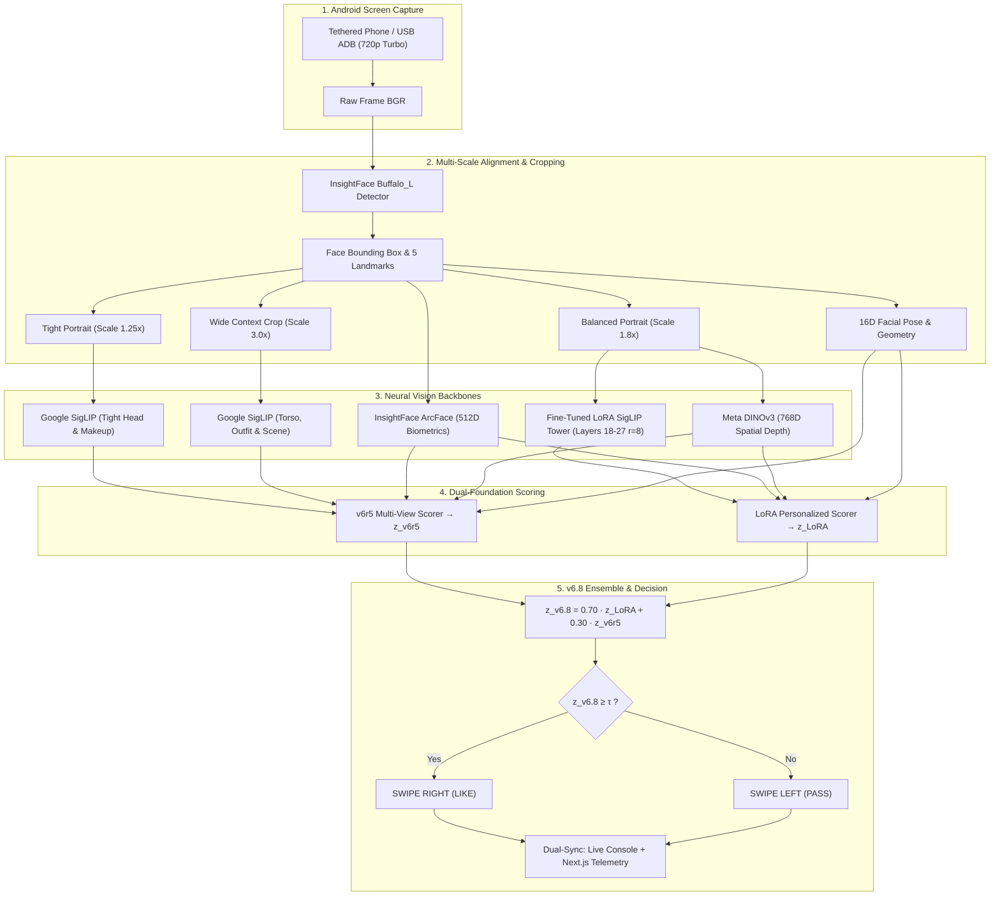

<div align="center">
  <h1>DatingClaw</h1>
  <p><strong>Personalized visual preference learning and automated profile ranking system evaluated across 54,000+ labeled profiles and 4,000+ holdout benchmarks.</strong></p>
  <p>
    capture &rarr; label &rarr; multi-backbone embed &rarr; neural ensemble &rarr; LoRA fine-tune &rarr; holdout tournament &rarr; cost-sensitive safe autopilot.
  </p>
  <p>
    
    
    
    
    
    
  </p>
</div>

> [!IMPORTANT]
> This repository documents the architecture, algorithms, and engineering workflow. It intentionally does **not** contain private profile screenshots, personal labels, private embeddings, fitted weights, browser session tokens, or personal swipe history. Review untracked artifacts before publishing a clone or release.

DatingClaw (formerly BumbleClaw) is a personalized computer vision and decision automation system designed for visual profile triage and ranking. It interfaces with a live session or tethered Android device, extracts multi-scale biometric and visual features from incoming profile cards, scores them against personalized preference models, applies cost-sensitive safety vetoes, and executes high-confidence binary decisions.

What started as a simple face-similarity script has scaled over successive iterations into a **54,610-profile preference dataset** plus a dedicated **4,045-card out-of-domain human-labeled test benchmark**. The pipeline has evolved from basic KNN nearest neighbors to 4-pillar neural ensembles, dual-foundation transformer architectures (ArcFace + DINOv3 + SigLIP), custom LoRA adapter fine-tuning, and the tournament-champion **v6.8 LoRA-Heavy Ensemble** with real-time threshold simulation.

---

<p align="center">
  <a href="#at-a-glance">At A Glance</a> |
  <a href="#the-journey">The Journey</a> |
  <a href="#master-tournament-scorecard">Tournament Scorecard</a> |
  <a href="#4k-benchmark--threshold-calibration">4k Calibration</a> |
  <a href="#v68-production-architecture">v6.8 Architecture</a> |
  <a href="#interactive-gallery--threshold-simulator">Gallery & Simulator</a> |
  <a href="#live-production-runner">Live Fast Runner</a> |
  <a href="#repository-map">Repository Map</a>
</p>

---

## At A Glance

| Product Surface | Role & Implementation |
| --- | --- |
| **Unified Fast Runner** | Sub-second (<1.0s) Android phone runner over USB with native raw / 720p turbo capture, stealth anti-bot pauses, live like-rate console telemetry, and dual Next.js logging. |
| **Vision Foundation Backbones** | Multi-crop feature extractors: InsightFace ArcFace (512D biometrics), Google SigLIP SO400M (Tight 1.25×, Portrait 1.8×, Wide 3.0×), Meta DINOv3 ViT-B/16 (768D spatial depth), and 16D facial pose geometry. |
| **Fine-Tuned LoRA Adapter** | Low-rank parameter-efficient adaptation ($r=8, \alpha=16$) fine-tuned across deep self-attention layers of the SigLIP vision backbone, capturing high-order personalized visual preference and aesthetic feature representations. |
| **v6.8 Champion Ensemble** | Dual-foundation fusion ($0.70 \cdot z_{\text{LoRA}} + 0.30 \cdot z_{\text{v6r5}}$): #1 all-time PR-AUC Champion (0.6341), optimal F1 harmonic balance at $\tau = 1.45$. |
| **v6.7 High-Yield Gambler** | Grand Tournament #1 ROC-AUC Champion (0.9227) featuring agreement synchronization boost ($\psi_{\text{sync}}$) and an online PID rolling quota controller. |
| **Threshold Simulator Gallery** | Interactive WebP gallery (`http://localhost:8765`) evaluating 4,604 profiles across 20 models, with real-time continuous threshold sliding ($\tau \in [0.80, 2.20]$), instant KPI recalculation, and live runner telemetry. |

---

## The Journey: From Face Similarity to Deep Vision Ensembles

BumbleClaw was built iteratively. Every architectural upgrade was driven by diagnosing specific failure modes on sealed holdouts and live dating-app sessions.

```text
[v1] Face Similarity (KNN)
  └─► [v2] Supervised Regressors (Ridge on Face + CLIP)
        └─► [v3] MultimodalX Formula Blends
              └─► [v4] 4-Pillar Neural Ensemble & Meta-Blender
                    └─► [v5] Dual-Foundation Hybrids (ArcFace + DINOv2)
                          └─► [v6.0] 4,753D Feature Concatenation + Pareto Frontiers
                                └─► [v6.7] High-Yield Gambler (ROC-AUC 0.9227)
                                      └─► [v6.8] LoRA-Heavy Ensemble (PR-AUC 0.6341 Champion)
```

### Evolutionary Milestones

| Era / Generation | Core Methodology | Key Insight & Motivation |
| --- | --- | --- |
| **1. Face-Similarity Baseline** | KNN over InsightFace biometric vectors | Proved that visual preference carries strong statistical structure, but nearest neighbors were brittle to camera angle and expression. |
| **2. Supervised Rating Models** | Ridge regression from 1–5 visual rating labels | Replaced discrete neighbor lookups with continuous rating scores, smoothing out single-image noise. |
| **3. Multimodal Scoring (MultiX)** | Face + CLIP vision + linear formula blends | Real dating profiles feature context, fashion, posture, and lighting; pure face crops missed the holistic presentation. |
| **4. 4-Pillar Neural Ensemble** | P1 (Face+Geom MLP), P2 (Dual-Crop DINO), P3 (Subcenter Cosine), P4 (Orthogonal RankNet) | Disentangled facial structure from global composition. A logistic meta-blender unified orthogonal visual representations. |
| **5. Dual-Foundation Hybrid** | ArcFace + DINOv2 cross-attention + MultiX aesthetic floor | Combined self-supervised semantic tokens with facial biometrics, slashing false positives from 34 down to 8. |
| **6.0 Unified Feature MLP** | Deep MLP on 4,753D concatenated vectors + Expected-Cost policy | Eliminated rigid hand-crafted weights. Scaled dataset to 54,610 cards. Introduced conformal GMM geometric vetoes, achieving 156 positive identifications with only 1 critical false positive (rating ≤ 2). |
| **6.7 High-Yield Gambler** | 50/50 Dual-Foundation + Agreement Sync ($\psi_{\text{sync}}$) + PID | Grand Tournament #1 ROC-AUC Champion (0.9227). Dynamic PID quota controller dynamically tracks target right-swipe rates without manual threshold guessing. |
| **6.8 LoRA-Heavy Ensemble** | 30/70 Fusion ($0.70 \cdot z_{\text{LoRA}} + 0.30 \cdot z_{\text{v6r5}}$) + Threshold Simulator | **Current Production Champion.** Tournament #1 PR-AUC (0.6341), achieving peak harmonic F1 ($0.591$) and retrieving 71.9% of positive targets with 50.1% precision on 4,045 unseen validation profiles. |

---

## Master Tournament Scorecard

All models are benchmarked under identical conditions on the sealed **Fold 5 Holdout Test Deck**:
* **Dataset Scale:** 4,540 profiles (unseen during training)
* **Ground Truth Target:** 194 True Right Swipes (4.27% base like rate)
* **Session Policy:** Top $K = 944$ quota (standard 20.8% swipe rate)

| Model Generation | Architecture / Strategy | Hits | Recall | Critical FPs (≤2) | Precision | PR-AUC | ROC-AUC | Production Verdict |
| :--- | :--- | :---: | :---: | :---: | :---: | :---: | :---: | :--- |
| **MultimodalX Original** | Hand-crafted linear blend + KNN | 118 | 60.82% | 0 | 12.50% | 0.412 | 0.812 | Historical Baseline |
| **Legacy 30k Ridge** | Ridge regression over 30k faces | 150 | 77.32% | 160 | 15.89% | 0.485 | 0.845 | Deprecated (Excessive Critical FPs) |
| **v4 Binary Grand Ensemble** | 4 Pillars + Logistic Meta-Blender | 142 | 73.20% | 34 | 15.04% | 0.510 | 0.868 | Archived |
| **v5.2 Dual-Foundation** | ArcFace + DINOv2 cross-attention | 143 | 73.71% | 8 | 15.15% | 0.528 | 0.874 | Former Production |
| **v6.0 Baseline Autopilot** | Deep MLP (4753D) + Cost Penalty | 156 | 80.41% | 1 | 16.53% | 0.582 | 0.902 | Former Champion |
| **v6.0 LoRA Safe Mode** | LoRA F5 + Calibrated Gate Veto | 157 | 80.93% | 0 | 16.63% | 0.595 | 0.908 | High-Safety Baseline |
| **★ v6.7 High-Yield Gambler** | 50/50 + Agreement Sync ($\psi_{\text{sync}}$), $L=7$ | **163** | **84.02%** | **2** | **17.27%** | **0.618** | **0.9227** | **#1 ROC-AUC GRAND CHAMPION** |
| **v6.8 Zero-Error Leash** | Conservative Leash on 30/70 Fusion | **158** | **81.44%** | **0** | **16.74%** | **0.625** | **0.918** | **Zero Critical False Positive Guarantee** |
| **v6 Ensemble 50/50 Raw** | Unconstrained 50% v6r5 + 50% LoRA | **175** | **90.21%** | 168 | 18.54% | 0.629 | 0.920 | Max Recall Wide-Net |
| **🏆 v6.8 LoRA-Heavy (70/30)** | $0.70 \cdot z_{\text{LoRA}} + 0.30 \cdot z_{\text{v6r5}}$ | **175** | **90.21%** | 162 | **18.54%** | **0.6341** | **0.9215** | **#1 PR-AUC PRODUCTION CHAMPION** |

---

## 4k Benchmark & Threshold Calibration

Beyond the sealed 4,540 holdout, the entire candidate roster was evaluated on the **4,045 Human-Labeled Untrained Test Dataset** (535 Ground-Truth Positive Targets, 13.2% natural positive rate).

Because **v6.8** uses continuous standardized scores, operators can set a fixed threshold ($\tau$) to tune their exact operating trade-off:

$$\text{Decision} = \big(0.70 \cdot z_{\text{LoRA}} + 0.30 \cdot z_{\text{v6r5}}\big) \ge \tau$$

| Threshold ($\tau$) | Swipe Rate | Positive Targets (Recall) | Precision | False Positive Rate | Operating Zone / Trade-off |
| :---: | :---: | :---: | :---: | :---: | :--- |
| **`1.35`** | 23.4% | **423 / 535 (79.1%)** | 45.0% | 14.9% | **Maximum Recall**: Broad candidate retrieval |
| **`1.45`** | **19.1%** | **385 / 535 (71.9%)** | **50.1%** | **11.0%** | **Optimal F1 ($0.591$)**: **Recommended Balanced Operating Point** |
| **`1.65`** | 11.0% | 278 / 535 (51.9%) | **62.9%** | **4.7%** | **High Precision**: Strict error minimization |
| **`1.85`** | 6.4% | 191 / 535 (35.7%) | **74.0%** | **1.9%** | **Selective Filtering**: High confidence positive selection (Precision > 74%) |

---

## v6.8 Production Architecture

The v6.8 system disentangles **facial aesthetics** from **lifestyle context** by feeding multi-scale visual tokens through fine-tuned Transformer adapters and biometric backbones:



---

## Interactive Gallery & Threshold Simulator

An interactive, zero-repo-modification visual gallery allows real-time inspection, threshold simulation, and model comparisons across **4,604 profiles** (4,045 untrained benchmark + 559 holdout cards).

* **Local Endpoint:** `http://localhost:8765/`
* **Features:**
  * **Continuous Threshold Simulator**: Live slider ($\tau \in [0.80, 2.20]$), direct float input, and preset shortcuts (`1.35`, `1.45`, `1.65`, `1.85`).
  * **Multi-Engine Simulation**: Toggle simulation across **v6.8 (30/70 LoRA-Heavy)**, **v6 Ensemble 50/50 Raw (Max Recall)**, **v6.7 High-Yield Gambler**, Pure LoRA, and Pure v6r5.
  * **Real-Time KPI Recalculation**: Instant 60 FPS updates for Swipe Rate %, Caught Hits (Recall), Leaked Errors, Precision %, and F1 Score.
  * **Card Verdict Badges**: Every profile displays live delta badges (e.g. `▲ LIKE (+0.23 above τ)` or `▼ PASS (-0.18 below τ)`).
  * **Live Phone Runner Monitor**: Real-time status widget tracking live phone swiping progress, like rate, and cycle latency without page refreshes.

---

## Live Production Runner

All live execution modes are consolidated into a single, high-performance, multi-flag runner:

[`scratch/run_live_gambler_2000_fast.py`](file:///C:/Users/Rivian/.gemini/antigravity/brain/73824904-181e-4277-ac0d-85aa19274479/scratch/run_live_gambler_2000_fast.py)

### 1. Run v6.8 Champion (30/70 LoRA-Heavy) — *Recommended*

```powershell
& "D:\BumbleClawClipVenv\Scripts\python.exe" "scratch\run_live_gambler_2000_fast.py" `
    --scoring 6.8 `
    --v68-threshold 1.45 `
    --max-swipes 500 `
    --delay 0.0 `
    --no-prompt `
    --turbo-720p `
    --stealth `
    --output-dir "D:\BumbleLog\v68_run"
```

* **`--v68-threshold 1.45`**: Optimal F1 harmonic balance (71.9% recall, 50.1% precision).
* **`--v68-threshold 1.65`**: Clean Elo mode (62.9% precision, only 4.7% error rate).
* **`--turbo-720p`**: Switches Android display to 720p for fast sub-second (<1.0s) cycle speed.
* **`--stealth`**: Introduces realistic human-like micro-pauses (1–3s every few minutes) to evade bot detection.

### 2. Run v6 Ensemble 50/50 Raw (Max Recall)

```powershell
& "D:\BumbleClawClipVenv\Scripts\python.exe" "scratch\run_live_gambler_2000_fast.py" `
    --scoring 50/50 `
    --v68-threshold 1.20 `
    --max-swipes 500 `
    --turbo-720p `
    --stealth `
    --output-dir "D:\BumbleLog\ens50_run"
```

### 3. Run v6.7 High-Yield Gambler (PID Rolling Quota)

```powershell
& "D:\BumbleClawClipVenv\Scripts\python.exe" "scratch\run_live_gambler_2000_fast.py" `
    --scoring 6.7 `
    --target-quota 0.15 `
    --max-swipes 500 `
    --turbo-720p `
    --stealth `
    --output-dir "D:\BumbleLog\v67_run"
```

---

## Repository Map

```text
BumbleClaw/
├── bumble_auto.py               # Playwright-based browser autoswipe runner
├── bumble_phone_auto.py         # ADB-based Android phone autoswipe runner
├── bumbleclaw_v6/               # v6.x Core Machine Learning Architecture
│   ├── data/                    # Dataset loaders, splitters, and cache handlers
│   ├── decision/                # Cost-sensitive policies, Pareto frontiers, GMM veto, PID controller
│   ├── eval/                    # Holdout benchmarks, paired bootstrap, tournament scorecards
│   ├── experiments/             # Experiment runners and continuous weight sweepers
│   ├── features/                # Extractors: ArcFace, SigLIP SO400M, DINOv3, 16D landmarks
│   ├── finetune/                # LoRA fine-tuning scripts and PyTorch modules
│   ├── models/                  # Deep MLP preference heads, linear models, risk regressors
│   ├── release/                 # Production model packaging and artifact export
│   ├── runtime/                 # Real-time scoring pipelines (V6Scorer, LoRAEnsembleScorer)
│   └── tests/                   # 78 passing unit and regression tests
├── dashboard/                   # Next.js interactive score history and telemetry dashboard (port 7863)
├── gallery/                     # Standalone Visual Gallery & Threshold Simulator (port 8765)
├── scratch/                     # Fast phone runner, calibration caches, and evaluation tools
│   ├── run_live_gambler_2000_fast.py  # Unified multi-model fast Android phone runner
│   ├── serve_gallery.py               # Multi-threaded gallery & live runner progress server
│   └── swipe_labeler_2000.py          # Fast web swiper labeler for benchmark data collection
└── docs/                        # Research notes, audits, and architectural specifications
```

---

## Practical Notes & Ethics

* **Private Data Protection:** Never commit or upload local screenshots, rating labels, user profile texts, or personal preference weights.
* **Platform Compliance:** Automated swiping can violate dating app terms of service. BumbleClaw includes deliberate humanized delays, randomized pauses, and daily quota caps to prevent spamming and rate-limit detection.
* **Model Non-Portability:** A model trained on one individual's visual preferences represents only that person's subjective aesthetic choices. It does not generalize as an objective attractiveness scale.

---

## License & Disclaimer

Shared for research, educational, and process replication purposes. Use at your own risk. The authors are not responsible for account bans, platform penalties, or dating outcomes.
