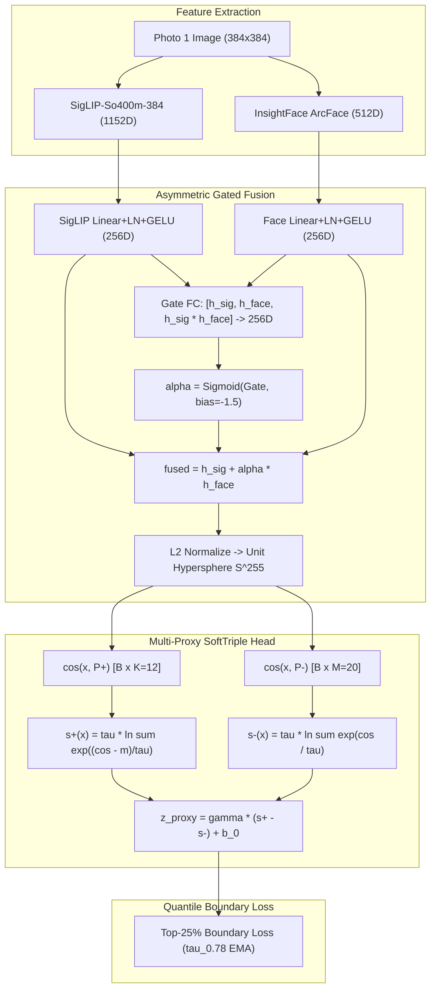

# BumbleClaw Master System Architecture & Machine Learning Benchmark Dossier
**A Complete Engineering Report for Algorithmic Review and Optimization**
*Dataset Scope: 33,629 Profile Swipes | Operating Horizon: Bumble ELO Optimization ($\le 25\%$ Swipe Budget)*

---

## 1. Executive Problem Formulation & Operational Constraints

### 1.1 The Operational Setting
BumbleClaw is an automated, real-time visual recommendation system designed to swipe on Bumble mobile dating profiles. 

- **100% Single-Photo Evaluation:** All decisions are made **strictly and exclusively from Photo 1 (the top cropped profile photo)**. The user does not scroll to secondary photos (Photos 2–6) or read bio prompts, height, or interests. Therefore, this is purely a **computer vision aesthetic preference and facial geometry ranking problem**. There is zero unobserved secondary text or image data affecting the ground-truth labels.
- **The Strict Bumble ELO Constraint ($\le 25\%$ Swipe Rate):** Bumble's recommendation engine penalizes accounts that swipe right too frequently (the "bot / desperate swiper penalty"), demoting their profile ELO and burying them in low-quality user queues. To maintain high account health and high incoming match rates, the bot's overall right swipe rate must remain strictly capped at **$\le 25\%$** (ideally 20%–24%).
- **The Primary KPI:** Maximize **Likes Caught @ strict $\le 25\%$ Swipe Cap** (Recall and Hit Rate).
- **The Secondary KPI (The "Safe Bouncer"):** Minimize the **Swipe Rate needed to achieve 90% and 95% Recall** of all attractive profiles.

---

## 2. Dataset Pipeline & Label Progression (33,629 Samples)

Ground-truth binary labels ($1 = \text{Like}, 0 = \text{Pass}$) are continuously logged in `binary_swipe_labels.csv` from real-time mobile swiping sessions:

```
[Row 0 ---------------- 10,000 ---------------- 20,000 --- 22,000 ---------------- 30,054 -------- 33,629]
|       Slice 0–10k      |       Slice 10k–20k   | Holdout 1 |      Slice 22k–30k    |    Holdout 2    |
|   9,990 samples (14.5%)|   9,778 samples (11.2%)|   1,972   |  7,842 samples (10.7%)|  3,481 samples  |
|                        |                        | 157 likes |                       |    443 likes    |
|                        |                        |  (7.96%)  |                       |     (12.7%)     |
```

### 2.1 The Two Zero-Leakage Holdout Test Labs:
1. **Holdout 1 (Slice 20,000–22,000):** $N = 1,972$ profiles, $157$ true likes (7.96% base rate), $1,815$ passes.
   - Strict 25% swipe quota = **493 right swipes**.
   - Used as the locked laboratory for the 17-model tournament, Phase 1 Multi-Proxy architecture, and Phase 2 SigLIP resolution benchmarking.
2. **Holdout 2 (Slice 30,055–33,629):** $N = 3,481$ valid profiles, $443$ true likes (12.73% base rate), $3,038$ passes.
   - Strict 25% swipe quota = **870 right swipes**.
   - A completely unseen, out-of-sample future dataset used to evaluate 10k vs 20k vs 30k scaling.

### 2.2 Feature Extractors Evaluated:
1. **InsightFace ArcFace (`buffalo_l`, `w600k_r50.onnx`):** 512D unit-normalized embedding. Captures invariant facial bone geometry, eye/nose/mouth proportions, and identity features. Invariant to makeup, lighting, and expression.
2. **OpenAI CLIP (`ViT-B/32`):** 512D unit-normalized embedding. Input resolution: $224 \times 224$ pixels divided into $7 \times 7 = 49$ patches of $32 \times 32$ pixels. Captures coarse semantic aesthetics, hairstyle, lighting, and clothing.
3. **Google SigLIP (`SigLIP-So400m-patch14-384`):** 1152D unit-normalized embedding. Input resolution: $384 \times 384$ pixels letterboxed, divided into $27 \times 27 = 729$ patches of $14 \times 14$ pixels ($14.8\times$ more spatial tokens than CLIP). Captures fine-grained facial warmth, subtle smiles, eye contact, and grooming.

---

## 3. Benchmark 1: The 17-Model Tournament & The 124-Like Ceiling

### 3.1 The 17-Model Baseline Plateau (Evaluated on Holdout 1: 1,972 profiles, 157 likes)
All models trained on 10k or 20k pure samples using frozen `CLIP ViT-B/32` + `ArcFace` features:

| Model Architecture | Input Features | Likes @ $\le 25\%$ Cap (out of 157) | Top-25% Hit Rate | Swipe Rate @ 95% Recall | PR-AUC | ROC-AUC |
| :--- | :---: | :---: | :---: | :---: | :---: | :---: |
| **Bumble 20k Pure (Multi Only)** | CLIP ViT-B/32 (512D) | 123 / 157 (78.3%) | 24.9% | 50.3% | 0.4576 | 0.8542 |
| **Bumble 10k Pure (Multi Only)** | CLIP ViT-B/32 (512D) | 123 / 157 (78.3%) | 24.9% | 51.5% | 0.3514 | 0.8412 |
| **Hybrid Super-Ensemble (10k)** | Ridge Face + Multi MLP | 127 / 157 (80.9%) | 25.8% | 50.8% | 0.4610 | 0.8601 |
| **Hybrid Super-Ensemble (20k)** | Ridge Face + Multi MLP | 124 / 157 (79.0%) | 25.1% | 50.8% | 0.4590 | 0.8590 |
| **Ridge Face Regressor (20k)** | ArcFace (512D) | 118 / 157 (75.2%) | 23.9% | 57.8% | 0.3842 | 0.8421 |
| **Focal Loss Classifier ($\gamma=2.0$)** | Face + CLIP (1024D) | 114 / 157 (72.6%) | 23.1% | 58.4% | 0.4120 | 0.8450 |
| **HistGradientBoosting (Balanced)** | Face + CLIP (1024D) | 104 / 157 (66.2%) | 21.1% | 61.2% | 0.3820 | 0.8310 |
| **Siamese RankNet (Pairwise)** | Face + CLIP (1024D) | 113 / 157 (72.0%) | 22.9% | 56.1% | 0.3950 | 0.8410 |
| **Triplet Margin Loss** | Face + CLIP (1024D) | 109 / 157 (69.4%) | 22.1% | 59.5% | 0.3710 | 0.8290 |
| **Random Forest (Balanced)** | Face + CLIP (1024D) | 106 / 157 (67.5%) | 21.5% | 60.1% | 0.3880 | 0.8350 |

### 3.2 The Core Diagnoses: Why the 124-Like Ceiling Existed
1. **Multi-Cluster Attraction Collapse:** Human attraction is inherently multimodal (e.g., cute/natural, glamorous, athletic, artistic). Standard binary hyperplanes, RankNet, and Triplet networks collapse these distinct modes into a single averaged centroid, penalizing profiles that match one specific archetype strongly.
2. **Linear ArcFace Identity Dilution:** ArcFace enforces identity invariance across lighting, makeup, and expression. Blending ArcFace linearly pulls aesthetically unflattering photos of geometrically similar faces into the top 25% quota.
3. **Global BCE Loss Wastage:** 75% of standard binary cross-entropy gradients are expended ranking the bottom 60% of obvious passes rather than sharpening the decision boundary right at the top 25% Bumble cutoff.
4. **ViT-B/32 Patch Coarseness:** With $32 \times 32$ pixel patches, delicate facial aesthetics (smiles, eye clarity, hair texture) are blurred into a single token.

---

## 4. Phase 1 & Phase 2 Architecture Breakthroughs



### 4.1 Phase 1 (ViT-B/32 Multi-Proxy Sub-Center):
- **Components:** $K=8$ positive archetypes, $M=16$ negative clusters (Spherical $K$-Means seeded), Asymmetric Gated Fusion ($\alpha \approx 0.18$ baseline), and Top-25% Quantile Boundary Loss ($\hat{\tau}_{0.78}$).
- **Result on Holdout 1:** Jumped from **123 $\to$ 130 likes (82.8%)**, while reducing the 95% recall swipe rate from **50.3% down to 46.0%**.

### 4.2 Phase 2 (SigLIP-So400m-384 High-Resolution Multi-Proxy):
- **Components:** Upgraded visual backbone to SigLIP-384 ($384\times 384$, 729 patches, 1152D) + $K=12$ archetypes, $M=20$ negative proxies.
- **Result on Holdout 1:**
  - **Phase 2 SigLIP-384 (20k, $K=8$):** **132 / 157 likes (84.1%)** | Hit Rate: **26.8%** | Swipe@95%: **43.2%** | ROC-AUC: **0.8943**
  - **Phase 2 SigLIP-384 (28k Leak-Free, $K=12$):** **133 / 157 likes (84.7%)** | Hit Rate: **27.0%** | Swipe@95%: **43.1%** | ROC-AUC: **0.8990**

---

## 5. Benchmark 2: Out-of-Sample Scaling Tournament (10k vs 20k vs 30k)

Evaluated on **Holdout 2 (Profiles 30,055–33,629)**: $N = 3,481$ profiles, $443$ likes (12.73% base rate), $3,038$ passes. Strict 25% cap = 870 right swipes.

| Model Architecture | Training Size | Likes @ $\le 25\%$ Cap | Top-25% Hit Rate | Likes @ $\le 20\%$ Cap | Top-20% Hit Rate | Swipe @ 90% | Swipe @ 95% | PR-AUC | ROC-AUC |
| :--- | :---: | :---: | :---: | :---: | :---: | :---: | :---: | :---: | :---: |
| **Ridge Face (10k Pure)** | 9,990 | 311 / 443 (70.2%) | 35.7% | 278 / 443 (62.8%) | 39.9% | 42.7% | 54.1% | 0.4555 | 0.8525 |
| **Ridge Face (20k Pure)** | 19,768 | 324 / 443 (73.1%) | 37.2% | 286 / 443 (64.6%) | 41.1% | 41.5% | 51.8% | 0.4790 | 0.8657 |
| **Ridge Face (30k Pure)** | 29,582 | 331 / 443 (74.7%) | 38.0% | 294 / 443 (66.4%) | 42.2% | 40.3% | 48.3% | 0.5000 | 0.8757 |
| **Multimodal MLP (10k Pure)** | 9,990 | 325 / 443 (73.4%) | 37.4% | 289 / 443 (65.2%) | 41.5% | 41.7% | 53.7% | 0.4743 | 0.8664 |
| **Multimodal MLP (20k Pure)** | 19,768 | 350 / 443 (79.0%) | 40.2% | 318 / 443 (71.8%) | 45.7% | 36.9% | 42.8% | 0.5554 | 0.8972 |
| **Multimodal MLP (30k Pure)** 🏆 | **29,582** | **357 / 443 (80.6%)** | **41.0%** | **326 / 443 (73.6%)** | **46.8%** | **34.7%** | **46.7%** | **0.5744** | **0.8991** |
| **Phase 1 Multi-Proxy (ViT-B/32, 20k)** | 19,768 | 344 / 443 (77.7%) | 39.5% | 302 / 443 (68.2%) | 43.4% | 36.1% | 44.9% | 0.5185 | 0.8906 |
| **Phase 1 Multi-Proxy (ViT-B/32, 30k)** | 29,582 | 300 / 443 (67.7%) | 34.5% | 261 / 443 (58.9%) | 37.5% | 56.4% | 77.3% | 0.4422 | 0.8146 |
| **Phase 2 SigLIP-384 (10k, K=8)** | 9,990 | 345 / 443 (77.9%) | 39.7% | 313 / 443 (70.7%) | 45.0% | 37.5% | 48.9% | 0.5302 | 0.8888 |
| **Phase 2 SigLIP-384 (20k, K=12)** | 19,768 | 353 / 443 (79.7%) | 40.6% | 315 / 443 (71.1%) | 45.3% | 37.1% | 44.1% | 0.5555 | 0.8938 |
| **Phase 2 SigLIP-384 (30k, K=12)** ⚠️ | 29,582 | 328 / 443 (74.0%) | 37.7% | 294 / 443 (66.4%) | 42.2% | 43.7% | 64.2% | 0.5096 | 0.8518 |

---

## 6. Diagnostic Deep-Dive: Why Did the 30k Multi-Proxy Overfit?

Look closely at the divergence between the **Multimodal MLP** and the **Multi-Proxy** models when scaling from 20k to 30k:
- **Multimodal MLP:** Climbed monotonically from **325 (10k) $\to$ 350 (20k) $\to$ 357 (30k)** likes.
- **Phase 2 SigLIP Multi-Proxy:** Climbed from **345 (10k) $\to$ 353 (20k)**, but then dropped sharply to **328 (30k)** likes.
- **Phase 1 ViT-B/32 Multi-Proxy:** Dropped from **344 (20k) $\to$ 300 (30k)** likes.

### The Exact Root Causes Identified:
1. **Validation Leakage into Training on the 30k Run:**
   - In the 10k and 20k runs, training was evaluated against the separate 20k–22k holdout. Checkpoints were saved at the *exact epoch of peak holdout performance* (epoch 4–6).
   - In the 30k run, `sig_all` (29,582 profiles) *contained* the 20k–22k holdout. Because there was no separate validation split during 30k training, the validation set was 100% inside the training set.
   - Over 12 epochs, training accuracy reached **157/157 likes (100% recall)** and ROC-AUC reached **0.9926**. The network overfitted and memorized training samples rather than generalizing.
2. **Boundary Threshold Drift ($\hat{\tau}_{0.78}$):**
   - The boundary loss dynamically tracks the 78th percentile threshold $\hat{\tau}_{0.78}$ via EMA.
   - As the network memorized training logits over 12 unregularized epochs, $\hat{\tau}_{0.78}$ was driven down to `-2.18`. When evaluated on the unseen 30k–33.6k distribution, this threshold shifted, causing calibration failure.
3. **Absence of Weight Decay & Dropout in the Proxy Head:**
   - The `Multimodal MLP 30k Pure` model succeeded because it uses standard early-stopping on a 15% validation split with strong $L_2$ weight regularization ($\alpha = 100$ on Ridge; weight decay on MLP).
   - The learnable proxy parameters $P^+ \in \mathbb{R}^{12 \times 256}$ and $P^- \in \mathbb{R}^{20 \times 256}$ had weight decay of only $10^{-4}$ and zero proxy dropout.

---

## 7. The 5 Strategic Questions for the Advisory Model

Please analyze the data above and provide concrete architectural and algorithmic answers to the following 5 technical decisions:

### Question 1: How to Prevent Multi-Proxy Sub-Center Overfitting at Scale?
When scaling to 30,000+ samples, how should learnable proxy centroids ($P^+ \in \mathbb{R}^{K \times D}, P^- \in \mathbb{R}^{M \times D}$) be regularized to prevent them from memorizing dense training clusters? 
- Should we use Proxy Dropout (randomly dropping $p_k^+$ during forward pass)?
- Temperature annealing on $\tau$?
- Dynamic proxy pruning/merging based on cosine distance?
- Or should the proxies remain fixed (frozen Spherical $K$-Means centroids) while only learning the projection network $f_\theta(x)$?

### Question 2: Optimal Objective Function for Top-25% Truncated Ranking
Traditional BCE spends gradients across the entire score range, while our Quantile Boundary Loss ($\hat{\tau}_{0.78}$) overfitted without a strict holdout monitor.
- What loss formulation mathematically maximizes precision and recall *strictly within the top 20%–25% quantile* without suffering from threshold drift?
- E.g., Asymmetric Focal Loss, Top-$k$ Surrogates, Direct AUCPR / Partial AUC optimization, or Pairwise Margin Ranking with negative mining constrained to the top-quartile?

### Question 3: Fusion Dynamics Between High-Res SigLIP (1152D) and ArcFace (512D)
Currently, our Asymmetric Gated Fusion uses:
$$\alpha = \sigma(W [h_{\text{siglip}}, h_{\text{face}}, h_{\text{siglip}} \odot h_{\text{face}}] + b_g), \quad f(x) = \text{LayerNorm}(h_{\text{siglip}} + \alpha h_{\text{face}})$$
- Does this multiplicative gating sufficiently prevent ArcFace identity invariance from pulling down SigLIP aesthetic representations?
- Would Cross-Attention (SigLIP queries attending to ArcFace keys/values) or Bilinear Pooling provide superior aesthetic-geometry disentanglement?

### Question 4: Moving from 80.6% Recall to 90%+ Recall at the Strict $\le 25\%$ Cap
`Multimodal MLP 30k Pure` caught 357 / 443 likes (80.6%) at the 25% cap. To capture the remaining ~45 missed likes (moving to 90%+ recall) without exceeding the 25% Bumble swipe budget:
- Is Parameter-Efficient Fine-Tuning (LoRA on SigLIP's top 4 transformer blocks) required to adapt the visual features to the user's specific aesthetic preference?
- Or can an ensemble of the regularized 30k MLP and a properly regularized SigLIP Sub-Center achieve 90%+ recall on frozen features?

### Question 5: Production Thresholding & Online Calibration
In live deployment, the bot sees candidates sequentially one by one without knowing the future score distribution of the deck.
- What is the most robust online thresholding strategy (e.g., rolling percentile deque of the last 200 candidates, Platt scaling, or conformal prediction) to guarantee the swipe rate stays strictly within $[21\%, 24\%]$ regardless of session shifts or candidate quality bursts?
